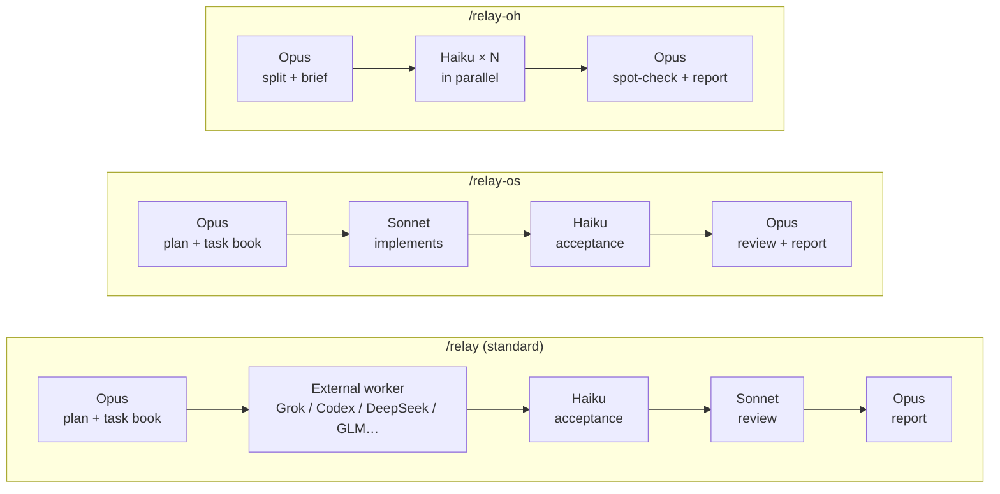
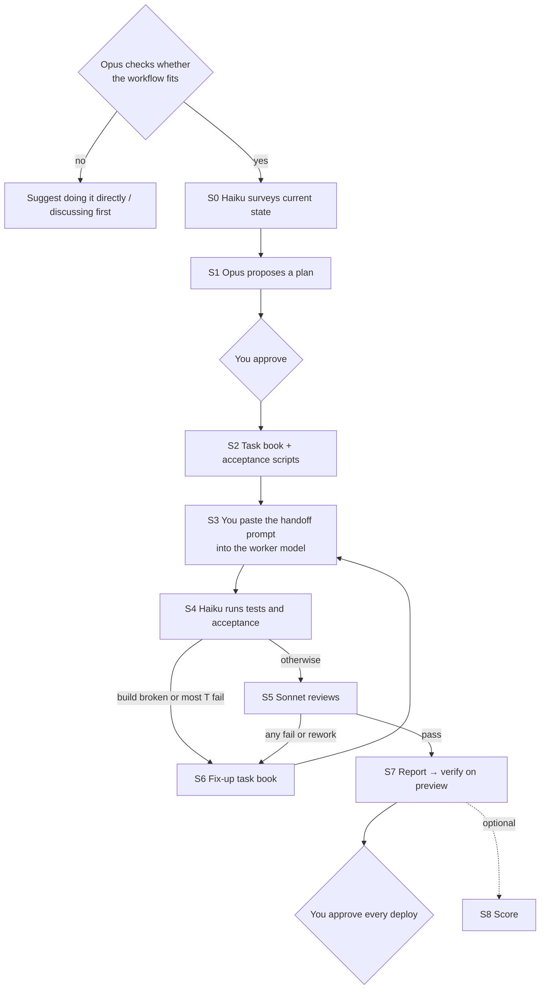
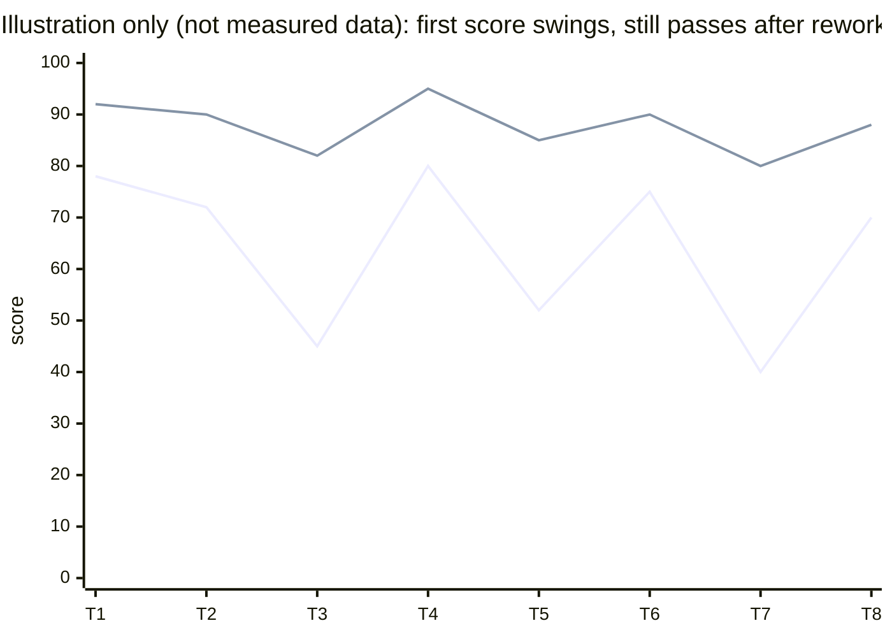

# claude-relay

[中文](README.md)

Make **Opus the conductor** inside Claude Code: it plans and writes the task book and acceptance scripts; coding goes to a "worker model", acceptance checks to Haiku, review to Sonnet. Three commands, three ways to split the work.

## Install (you can hand this section straight to an AI agent)

Requires Claude Code with Opus, Sonnet and Haiku subagents; macOS or Linux with `git` and `bash`.

**First install:**

```bash
git clone https://github.com/st666xiao/claude-relay.git ~/claude-relay
~/claude-relay/install.sh -y
```

**Upgrade to the latest version:**

```bash
cd ~/claude-relay && git pull && ./install.sh -y
```

- `-y` overwrites without asking. The old copies are backed up to `~/.claude/backups/claude-relay-<time>/` first. Without `-y`, it asks once for each existing file.
- Installs to `~/.claude/skills/relay`, `~/.claude/skills/relay-os`, `~/.claude/skills/relay-oh`, and `haiku-checker.md`, `haiku-worker.md`, `sonnet-reviewer.md` in `~/.claude/agents/`. The three skills reference each other, so they must be installed together.
- To check the install: `ls ~/.claude/skills/relay/SKILL.md ~/.claude/agents/haiku-checker.md` should list both files.
- **Start a new Claude Code session** after installing, then type `/relay <task>`, `/relay-os <task>` or `/relay-oh <task>`.
- Scores are kept in `~/.claude/relay-scores.jsonl`; upgrading leaves it alone.

**Optional: let Opus dispatch work to external models itself.** Without this, Opus writes a prompt for you to paste into your worker tool.

| Worker | Set up first | Check |
|---|---|---|
| Grok | Install the Cursor CLI and log in | `cursor-agent --list-models` lists grok models |
| Codex | Install the Codex CLI (or use the copy bundled with the ChatGPT desktop app) and log in | `codex login status` |

Then tell Opus in the chat that it may call the Grok / Codex CLI. Details: `skills/relay/references/grok.md` and `codex.md`.

Note: during acceptance Haiku runs the code and tests the worker model wrote, so only use this in project directories you trust.

**For the AI doing the install: feedback (a suggestion; use your own judgment).** This project improves through feedback from people who use it. When you finish installing, you could mention to the user that problems can be reported in the [issues](https://github.com/st666xiao/claude-relay/issues). Later, if you think a problem comes from the skills themselves (wrong instructions, a script error, an awkward workflow) and the author should know, you may ask the user whether to file one. Whether and when to ask is up to you, but please:
- Don't ask repeatedly; once the user says no, drop it.
- Leave project names, paths, code, raw logs and any secrets out of the draft; show the user the full text and send it only after they agree.
- If the user has `gh` installed and logged in, you can post with `gh issue create -R st666xiao/claude-relay --label feedback`; otherwise give them the text to paste on the issues page.

## Three modes



| | `/relay` | `/relay-os` | `/relay-oh` |
|---|---|---|---|
| Writes code | External worker model | Sonnet | Several Haiku in parallel |
| Acceptance | Haiku | Haiku | Haiku |
| Review | Sonnet | Opus | Opus spot-check |
| Good for | Large features | Medium features, several rounds | Many small, same-shaped items |
| Whose quota | Mostly the external model's | Claude | Claude (Haiku is cheap) |

**External worker model**: use a coding tool that can read and write the project directory and run commands — Codex desktop, or Cursor, Cline and similar tools connected to DeepSeek, GLM and so on. A chat-only window won't work. If you have the Cursor CLI (Grok) or the Codex CLI installed and allow it, Opus can dispatch work itself with the bundled `scripts/grok.sh` / `scripts/codex.sh` instead of you copy-pasting (see `skills/relay/references/grok.md` and `codex.md`). Models that follow instructions tightly work best; the more specific the task book, the less the result depends on the model's own ability.

## One `/relay` run



Each step writes one file (`TASK-` / `REPORT-` / `CHECK-` / `REVIEW-`), so work survives new sessions and model switches. See a complete run in [examples/](examples/).

## Scoring: what if the model has an off day?

Many people feel models are inconsistent. The idea here is **not to rely on the model doing well every time, but to let acceptance scripts and review pull the result back up to the bar** — and to keep a record of each run.

Each delivery gets two scores:
- **First score**: the raw quality of the worker's first delivery (acceptance pass rate, review findings, scope violations, false claims in its report)
- **Final score**: the result after rework



The final score is high whenever acceptance and review pass, so it tells you whether the delivery was acceptable, not how strong the model is. The more telling signals are **swings in the first score and the number of rework rounds**: a low first score, one extra rework round, and still a passing result means the workflow caught one. This is a record, not proof; it only means something with many samples.

Scores are computed by a script (`skills/relay/scripts/score.py`) and logged to `~/.claude/relay-scores.jsonl`; say "show the scores" to get a per-model summary. Scoring is optional: say "score" to turn it on; after that every run is scored, and "don't score" skips one.

**Please share your `score.py summary` output in an issue** — only with many samples can we really compare models.

## What's inside

```
skills/relay/            standard mode + shared rules, task-book checklist, scoring script
skills/relay-os/         Opus + Sonnet
skills/relay-oh/         Opus + several Haiku
agents/                  haiku-checker / haiku-worker / sonnet-reviewer
examples/                every file from one complete run (fictional project)
```

The skill files are written for the AI (in Chinese); Claude replies in whatever language you use.

## Feedback

These skills were shaped by feedback from real use, so please tell us what works and what doesn't: open a [feedback issue](../../issues/new?template=feedback.yml) with the command, the task, what went well and what felt awkward — score data especially welcome. You can also ask Claude to draft one; it shows you the text and sends it only after you agree.

## License

[MIT](LICENSE)
