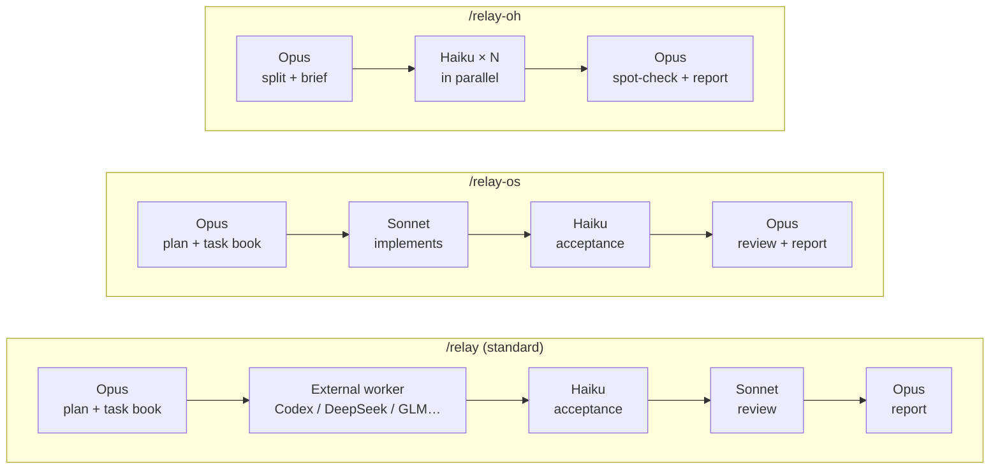
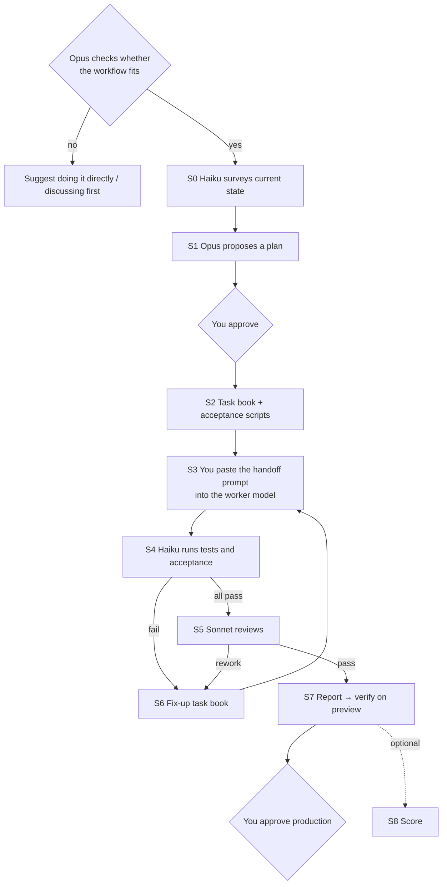
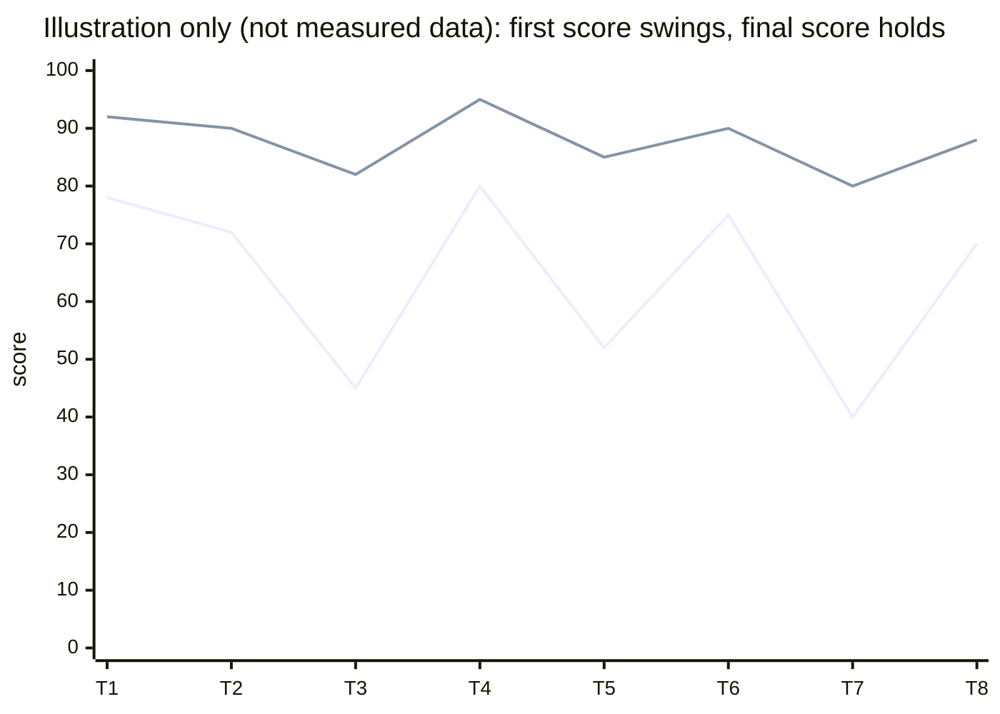

# claude-relay

[中文](README.md)

Make **Opus the conductor** inside Claude Code: it plans and writes the task book and acceptance scripts; coding goes to a "worker model", acceptance checks to Haiku, review to Sonnet. Three commands, three ways to split the work.

## Three modes



| | `/relay` | `/relay-os` | `/relay-oh` |
|---|---|---|---|
| Writes code | External worker model | Sonnet | Several Haiku in parallel |
| Acceptance | Haiku | Haiku | Haiku |
| Review | Sonnet | Opus | Opus spot-check |
| Good for | Large features | Medium features, several rounds | Many small, same-shaped items |
| Whose quota | Mostly the external model's | Claude | Claude (Haiku is cheap) |

**External worker model**: any tool that can read a task book and write a report — Codex desktop, DeepSeek, GLM and so on. Models that follow instructions tightly work best; the more specific the task book, the less the result depends on the model's own ability.

## One `/relay` run



Each step writes one file (`TASK-` / `REPORT-` / `CHECK-` / `REVIEW-`), so work survives new sessions and model switches. See a complete run in [examples/](examples/).

## Scoring: what if the model has an off day?

Many people feel models are inconsistent. The idea here is **not to rely on the model doing well every time, but to let acceptance scripts and review pull the result back up to the bar** — and to record that in numbers.

Each delivery gets two scores:
- **First score**: the raw quality of the worker's first delivery (acceptance pass rate, review findings, scope violations, false claims in its report)
- **Final score**: the result after rework



If first scores drop while final scores hold, the workflow caught it. Scores are computed by a script (`skills/relay/scripts/score.py`) and logged to `~/.claude/relay-scores.jsonl`; say "show the scores" to get a per-model summary. Scoring is optional — say "score" to turn it on.

**Please share your `score.py summary` output in an issue** — only with many samples can we really compare models.

## Install

```bash
git clone https://github.com/st666xiao/claude-relay.git
cd claude-relay
./install.sh
```

Then **start a new Claude Code session** and type a command plus your task:

```
/relay-os fix the reader's page-turn stutter
```

Before starting, Opus tells you whether the task fits the workflow at all, and suggests doing small tasks directly.

Requires Claude Code with Opus, Sonnet and Haiku subagents; `/relay` also needs an external worker model.

## What's inside

```
skills/relay/            standard mode + shared rules, task-book checklist, scoring script
skills/relay-os/         Opus + Sonnet
skills/relay-oh/         Opus + several Haiku
agents/                  haiku-checker / haiku-worker / sonnet-reviewer
examples/                every file from one complete run (fictional project)
```

The skill files are written for the AI (in Chinese); Claude replies in whatever language you use.

## Feedback

After trying it, please open a [feedback issue](../../issues/new?template=feedback.yml): which command, what task, what went well, what felt awkward — score data especially welcome.

## License

[MIT](LICENSE)
