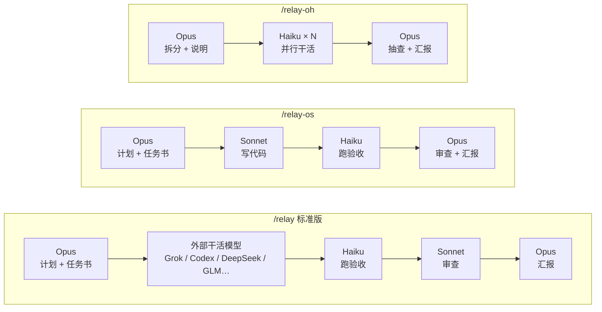
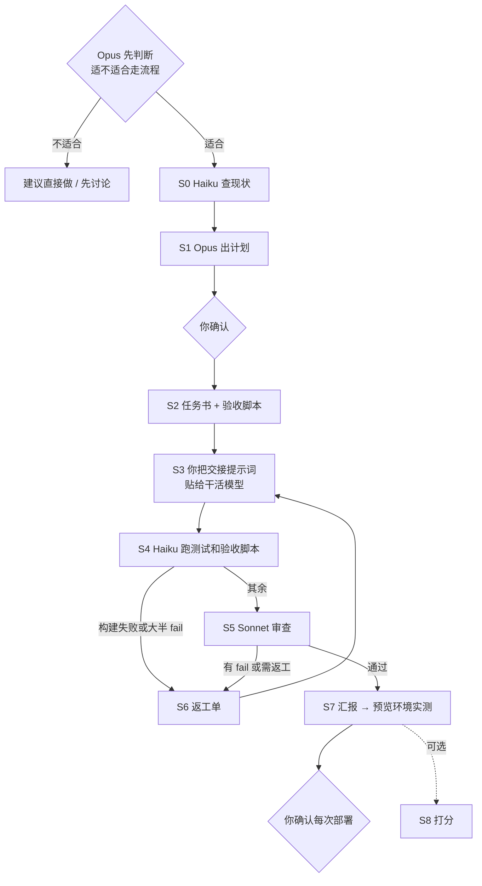
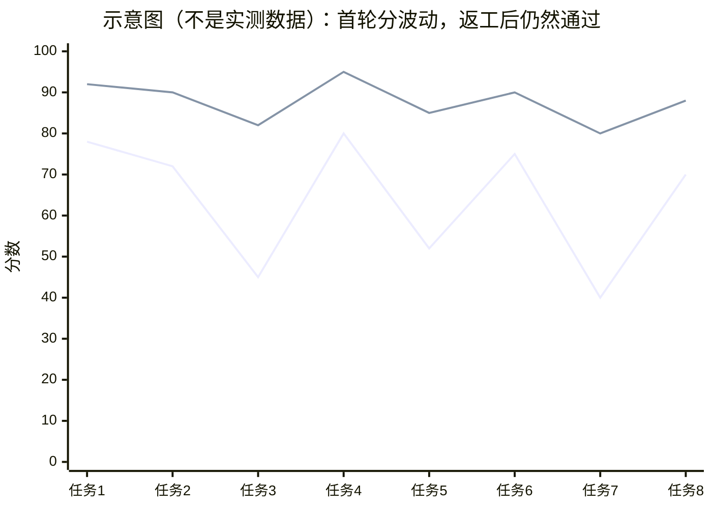

# claude-relay

[English](README.en.md)

让 Claude Code 里的 **Opus 当总指挥**：它定计划、写任务书和验收脚本；写代码交给"干活模型"，验收交给 Haiku，审查交给 Sonnet。三个命令，三种分工。

## 三种模式



| | `/relay` | `/relay-os` | `/relay-oh` |
|---|---|---|---|
| 写代码 | 外部干活模型 | Sonnet | 多个 Haiku 并行 |
| 验收 | Haiku | Haiku | Haiku |
| 审查 | Sonnet | Opus | Opus 抽查 |
| 适合 | 大功能 | 中等功能、多轮修改 | 量大、每份一样的小活 |
| 用谁的额度 | 主要是外部模型 | Claude | Claude（Haiku 很省） |

**外部干活模型**：要用能直接读写项目目录、运行命令的编码工具，比如 Codex desktop，或者接上 DeepSeek、GLM 的 Cursor、Cline 等。只有聊天窗口的不行。装了 Cursor CLI（Grok）或 Codex CLI 并授权后，Opus 可以用自带的 `scripts/grok.sh`、`scripts/codex.sh` 直接派活，不用你来回粘贴（说明在 `skills/relay/references/grok.md`、`codex.md`）。约束力强、按要求干活的模型最合适——任务书写得越具体，对模型本身能力的依赖越小。

## 一次 `/relay` 的过程



每一步产出一个文件（`TASK-` / `REPORT-` / `CHECK-` / `REVIEW-`），换 session、换模型都能接上。完整样例见 [examples/](examples/)。

## 打分：模型"降智"了怎么办

很多人觉得模型时好时坏。这套流程的思路是：**不依赖模型每次都发挥好，用验收脚本和审查把结果拉回合格线**，并且把每次的情况记下来。

每次交付记两个分：
- **首轮分**：干活模型第一次交出来的原始质量（验收通过率、审查问题数、越界、报告不实）
- **最终分**：返工之后的结果



最终分只要验收和审查都过了就会偏高，所以它说明的是"交付是否合格"，不是模型多强。更值得看的是**首轮分的波动和返工轮数**：首轮分掉下去、返工多了一轮、最终仍然通过，就是流程兜住了一次。这是记录，不是证明；样本多了才有意义。

分数由脚本计算（`skills/relay/scripts/score.py`），记录在 `~/.claude/relay-scores.jsonl`，说一句"看看分数"就能按模型汇总。打分是可选的：说"打分"开启，之后每次自动打分，说"不打分"跳过。

**欢迎把你的 `score.py summary` 结果贴到 issue 里**，样本多了才能真正看出不同模型的差别。

## 安装

```bash
git clone https://github.com/st666xiao/claude-relay.git
cd claude-relay
./install.sh
```

然后**新开一个 Claude Code session**，输入命令加任务：

```
/relay-os 修复阅读器翻页卡顿
```

每个命令开始前，Opus 会先告诉你这个任务适不适合走流程，小任务会建议直接做。

需要：Claude Code（能用 Opus、Sonnet、Haiku 子代理）；`/relay` 还需要一个外部干活模型。三个 skill 互相引用，要一起安装（`install.sh` 会装全）。

注意：验收时 Haiku 会运行干活模型写出来的代码和测试，请只在你信任的项目目录里使用。

## 仓库里有什么

```
skills/relay/            标准版 + 共用的规则、任务书清单、打分脚本
skills/relay-os/         Opus + Sonnet
skills/relay-oh/         Opus + 多个 Haiku
agents/                  haiku-checker / haiku-worker / sonnet-reviewer
examples/                一次完整流程的全部文件（虚构项目）
```

skill 文件是写给 AI 看的（中文），回复会用你说话的语言。

## 反馈

用过之后欢迎开一个 [使用反馈 issue](../../issues/new?template=feedback.yml)：用了哪个命令、什么任务、哪里顺、哪里别扭，有打分数据更好。

## License

[MIT](LICENSE)
